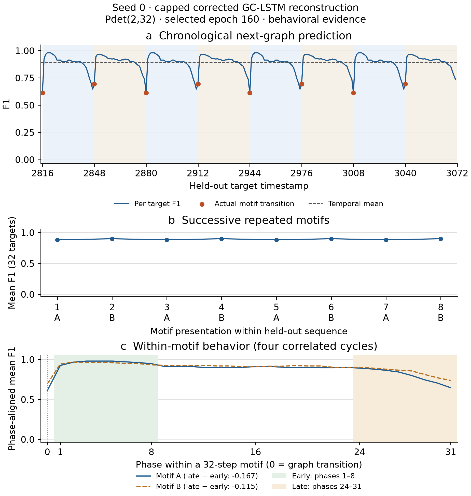
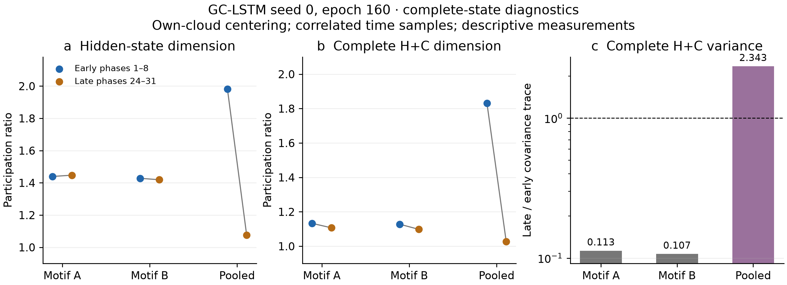

# Figure 10: verified GC-LSTM after the 200-epoch fit

2026-10-20. **The validation-selected epoch-160 GC-LSTM from the corrected
seed-0, 200-epoch fit reproduces the qualitative within-motif F1 decline.** In the frozen
windows, mean F1 falls from **0.959297 to 0.818771**, a difference of
**−0.140526**, or **14.0526 percentage points**. Both motifs show the decline.
This is a corrected single-model reconstruction of the behavior motivating
[T-GRAB Figure 10](https://arxiv.org/abs/2507.10183), not the complete
multi-method, five-seed figure, a historical checkpoint replay, or a causal
representation-collapse result.

The [machine-readable results](figure10-gclstm-longfit-results-2026-10-20.json)
and [compact evidence inventory](figures/figure10-gclstm-longfit-2026-10-20/evidence-inventory.json)
pin the accepted sources, original receipts, per-target results and copied
figures. The earlier [one-hour pilot](figure10-gclstm-pilot-results-2026-10-19.md)
remains a separate, unchanged result.

## Training, selection and one held-out evaluation

Mila job **11322268** completed `0:0` after **9 h 12 min 16 s**. It performed
**200 complete epochs and 511,800 optimizer updates**, then stopped at its
frozen epoch cap. Strict validation-only improvement with earliest ties selected
**epoch 160**, validation F1 **0.8918793674179636**. The run did not stop at a
convergence criterion or reproduce the original manuscript's uncapped patience
rule. The 48-hour allocation ceiling was a maximum, not the observed runtime.

The [long-fit v2 contract](figure10-long-fit-v2-2026-10-19.md) was frozen before
the pilot's held-out evaluation. The fit started from fresh seed-0 native models
and optimizer, independently matched the first 256 losses against the accepted
pilot prefix, and used unchanged CPU FP32 numerical settings. Seed 1 initializes
the negative generator. Training targets are 1–2559, with one optimizer update
per target; validation targets are 2560–2815 after a fresh zero-state replay.
All 200 complete candidates were retained under the original primitive-v2
format. The actual executed long-fit contract and numerical/conversion template
have distinct identities; no v1 checkpoint head or replacement v1 manifest was
manufactured.

Selected evaluation job **11330003** completed `0:0` in **56 s**. Its
[reviewed v3 protocol](figure10-selected-evaluation-v3.md) authenticated the real
finalized v2 selection pointer and selected candidate. Fresh native construction
matched the accepted initialization and post-construction observations. The
worker strictly loaded both recurrent and link-head components, verified their
post-load bytes, and replayed snapshots 0–2815 from positive-zero hidden and
cell state. Every H/C byte at state `s[2816]` had to match the selected terminal
artifact, including signed zeros, before the single held-out opener.

The 256 targets, **2816–3071**, were scored before each target was consumed.
Each score uses all **9,900 ordered off-diagonal pairs** and threshold `>=0.5`.
A durable fit-bound charge prevents another selected load/test pass under a new
output name. Passive clones captured the full pre-score hidden and cell state
without another model evaluation or extra test read. The 25 MiB binary trajectory
stays on scratch.

Independent execution verification checked every optimizer intent/outcome
hash chain, epoch seal, raw loss event, validation confusion count, selection
receipt and finalization. It also decoded **563,200 actual offline W&B fit
history rows** and **258 evaluation history rows**, including result artifacts
and successful terminal framing. These are execution and compact-arithmetic
checks; the verifier did not independently execute native inference or read the
native weight/state payloads locally. **Remote W&B delivery remains unverified.**
The fit, evaluation and subsequent state analysis each used **one CPU, 2 GiB, zero GPUs** through cluv.

## Frozen behavioral comparison

[Vector PDF](figures/figure10-gclstm-longfit-2026-10-20/figure10-reconstruction.pdf),
[256-target CSV](figures/figure10-gclstm-longfit-2026-10-20/figure10-reconstruction.csv),
[phase-aligned CSV](figures/figure10-gclstm-longfit-2026-10-20/figure10-within-motif.csv).
The PDF was rendered independently with PyMuPDF and visually checked for
legible axes, correct epoch-160 labeling, windows, transitions and legends.

The [descriptive window protocol](figure10-within-motif-descriptive-2026-10-19.md)
was frozen before the earlier pilot's held-out curve. It compares phases **1–8**
with **24–31** inside each 32-step motif and excludes transition phase **0**.
The long-fit analysis reuses these windows unchanged. Each motif/window has
32 correlated targets; each balanced pooled window has 64.

- Motif A: early **0.964196**, late **0.797668**, difference **−0.166528**.
- Motif B: early **0.954398**, late **0.839874**, difference **−0.114524**.
- Balanced pooled: early **0.959297**, late **0.818771**, difference **−0.140526**.
- Overall temporal mean: **0.891900**. The eight transition targets average
  **0.653175**; the other 248 targets average **0.899601**.

The [independent interpretation](figures/figure10-gclstm-longfit-2026-10-20/evidence/behavioral-interpretation.json)
confirms the arithmetic and distinguishes within-motif decline from cumulative
change across cycles. The four cycle means are **0.891848, 0.891929, 0.891929,
0.891894**. Across the four cycles, **61 of 64 phases** have identical reported
confusion counts and F1; phases 61–63 differ slightly, with maximum
phase-aligned F1 range **0.002749**. Thus neither exact behavioral periodicity
nor cumulative decline is claimed. A fixed early/late contrast is also not a
claim that every adjacent step decreases.

The independently verified analytic **Persistence baseline has mean F1
0.96875**, with 0 at transitions and 1 elsewhere. The trained model still
underperforms this baseline overall, despite stronger performance than the
one-hour pilot. Neither comparison is a paired model-seed estimate: these are
one selected model, one graph realization and one contiguous sequence. The
four cycles are correlated observations, not four independent replications.
There are no seed confidence intervals or inferential tests.

## Complete-state diagnostics: modest PR decline and strong variance attenuation

Analysis job **11330070** completed `0:0` in **40 s** on the captured trajectory,
with no additional native inference or test read. It used the unchanged
[frozen FP64 diagnostic protocol](figure10-trajectory-diagnostics-2026-10-19.md).
Independent compact verification accepted all **21 covariance spectra**,
**192 lag-64 state comparisons** and **22 actual offline W&B history rows**.
It checked reported spectral arithmetic and source/input lineage, but did not
independently reanalyze the binary state array.

[Vector PDF](figures/figure10-gclstm-longfit-2026-10-20/figure10-state-diagnostics.pdf).
The figure uses the actual epoch-160 upstream receipt. Adaptive PR axes are a
recorded display policy, and trace ratios are a posthoc display of the frozen
covariance traces, not a newly selected confirmatory estimand. This PDF was
also rendered independently and visually checked.

Each time cloud is centered on its own mean, with unbiased denominator `n−1`.
Per-motif windows have 32 correlated rows and covariance rank ceiling **31**;
pooled windows have 64 rows and ceiling **63**. The full 256-row cloud has
ceiling **255**. These are temporal trajectory clouds, not cue-conditioned
memory distributions or independent population samples. H+C concatenates the
native hidden/cell coordinates without rescaling, so its covariance geometry
depends on component units and is dominated here by cell-state variance.

**Complete H+C participation ratio declines modestly within both motifs:**
A **1.132672 → 1.107023**, B **1.128029 → 1.098119**. Meanwhile absolute joint
covariance trace falls strongly: A **3759.788 → 423.859** and B
**3765.729 → 402.468**. The accepted late/early trace ratios are **0.112735**
and **0.106876**. These support attenuation of centered within-motif variation
with a modest shift in normalized spectral concentration; they do not imply
that the whole state norm shrinks or that useful information was erased.
Threshold-defined numerical ranks actually rise **18 → 19** for A and
**18 → 20** for B. Participation ratio and numerical rank are different
estimands and do not give a uniform dimension-loss conclusion.

**Hidden-only PR is mixed:** A **1.439486 → 1.447278** rises slightly, while
B **1.427974 → 1.419179** falls slightly. Hidden covariance traces fall from
**120.600 → 15.152** and **127.639 → 14.335**, respectively. Thus the long fit
does not reproduce a universal hidden-only PR decrease. The one-hour pilot
instead showed hidden PR falling while within-motif H+C PR rose. That
checkpoint/run contrast is descriptive, not a causal training-duration study.

**Pooling motifs gives a larger PR decline while variance increases:**
pooled H+C PR is **1.830506 → 1.027825**, but pooled covariance trace is
**11095.624 → 26000.943**, a late/early ratio of **2.343351**. A pooled cloud
mixes within-motif variation with between-motif mean separation. Its large PR
change therefore cannot be treated as the same estimand as either within-motif
comparison, or as evidence for uniformly shrinking complete-state variation.

Complete states are **not bitwise period-64 closed**: the maximum relative
lag-64 L2 residual is **0.01167929**. No Jacobian, tangent propagator or Floquet
operator was measured. Neither periodic input nor nearly repeated F1 certifies
a periodic complete-state orbit or periodic Jacobians.

## Scientific decision and remaining scope

Accepted now: **qualitative within-motif F1 deterioration is observed for the
validation-selected epoch-160 checkpoint of the corrected 200-epoch fit**, under the same
predeclared descriptive comparison. The stronger fit resolves the concern that
the only behavioral reconstruction was the seven-epoch deadline pilot; it does
not establish a general training-duration effect from two checkpoints/runs.

Open: whether the decline reflects loss of task-required information,
readout/calibration or threshold effects, phase tracking, saturation, or another
state-transition mechanism. There is no matched nonperiodic ordering
intervention at equal retention horizon in this graph benchmark. Harmful memory
erasure, a universal complete-state collapse mechanism, Floquet contraction and
cross-modal generality remain unresolved.

The [coverage audit](figure10-coverage-and-next-fit-2026-10-19.md) still identifies
the missing methods and historical seed/curve provenance. Next steps are to
expand the explicitly frozen model-seed cohort and remaining Figure 10 methods, and test matched ordering and retention
controls with causal interventions and shams. Full Figure 10 and native
cross-modal reproduction remain prospective.

## Evidence boundaries

The [evidence directory](figures/figure10-gclstm-longfit-2026-10-20/evidence/)
contains original compact fit/evaluation acceptance receipts, summaries,
selected-candidate metadata, all per-target scores, reporting receipts and the
independent behavioral interpretation, accepted state-analysis output and its
verification receipt. Plot manifests bind the copied PDF/PNG
and CSV bytes to a distinct plot-acceptance projection, which pins the full
execution acceptance. It contains no model weights, binary states, datasets,
optimizer journals, W&B streams, credentials or provider configuration.

An [independent scientific review](figure10-longfit-independent-scientific-review-2026-10-20.md)
accepts the descriptive execution and compact arithmetic with the limitations
above; it does not accept causal representation collapse.
