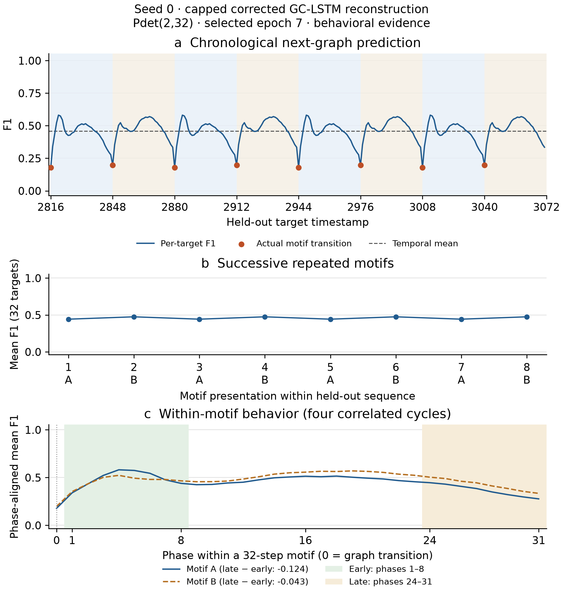
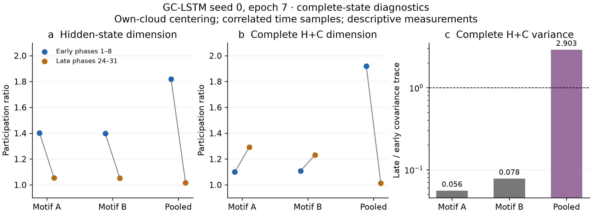

# Figure 10: verified GC-LSTM behavioral reconstruction

2026-10-19. **The corrected seed-0 GC-LSTM pilot reproduces the qualitative
within-motif F1 decline highlighted in T-GRAB Figure 10.** In the frozen
windows, mean F1 decreases from **0.477737 to 0.394132**, a decline of
**8.3605 percentage points**. This is one capped model on one graph realization,
not the complete multi-method, five-seed figure or a historical checkpoint replay.

The complete machine-readable record is
[results JSON](figure10-gclstm-pilot-results-2026-10-19.json).
The [coverage audit](figure10-coverage-and-next-fit-2026-10-19.md) identifies
all eleven methods and the unresolved historical provenance. The target is
[Dizaji et al., Figure 10](https://arxiv.org/abs/2507.10183), Pdet(2,32).

## Executed reconstruction and verification

Mila fit job **11321105** completed `0:0` in **58 min 26 s**, with **7 complete
epochs and 18,429 optimizer updates**, including the charged partial eighth
epoch. Validation-only strict earliest-tie selection chose epoch 7, F1
**0.4592774313983113**. The actual stopping reason is the registered one-hour
pilot deadline. It is not converged training or the manuscript's uncapped
patience rule. The numerical settings, data/source pins, CPU FP32, seeds,
chronology and differences from the public trainer are in the
[frozen fit protocol](figure10-full-fit-2026-10-19.md).

Selected evaluation job **11322413** completed `0:0` in **2 min 45 s**. It
strictly reloaded both model components, replayed the full train/validation
prefix from zero hidden and cell state, and required an exact complete-state
match to the selected terminal state before its single test opener. It scored
256 chronological targets, 2816–3071, before consuming each target, using all
9,900 ordered off-diagonal node pairs and threshold `>=0.5`.

Independent compact-artifact verification reconciled selection, source/job
identities, charged updates, finalization, replay receipts, all confusion-derived
scores, reporting artifacts and actual offline W&B history. The audits decoded
20,228 fit history rows and 258 evaluation history rows. They did not execute an
independent native replay or transfer/reload the model weights locally. Online
W&B delivery remains unverified. All three short jobs used one CPU, 2 GiB and
zero GPUs; all were submitted through cluv 0.1.5 without automatic retries.

## What the behavioral curve shows

[Vector PDF](figures/figure10-gclstm-pilot-2026-10-19/figure10-reconstruction.pdf),
[256-target CSV](figures/figure10-gclstm-pilot-2026-10-19/figure10-reconstruction.csv),
[phase-aligned CSV](figures/figure10-gclstm-pilot-2026-10-19/figure10-within-motif.csv).

The [window protocol](figure10-within-motif-descriptive-2026-10-19.md) was frozen
before reading the held-out curve: early phases **1–8** versus late phases
**24–31**, excluding transition phase 0. Each per-motif window contains 32
correlated target observations; the balanced pooled window contains 64.

- Motif A: early **0.488950**, late **0.364600**, difference **−0.124350**.
- Motif B: early **0.466524**, late **0.423664**, difference **−0.042860**.
- Balanced pooled: early **0.477737**, late **0.394132**, difference **−0.083605**.
- Overall temporal mean: **0.459277**. The eight transition targets average
  **0.188305**; the remaining 248 average **0.468018**.

The curve is **not monotonically decreasing** inside each motif: it recovers,
oscillates and then falls. All 192 pairs of phase-matched targets one period
apart have identical reported confusion counts and F1. Thus these observations
show **recurring within-motif deterioration, not cumulative behavioral decline
across the four cycles**. Quantized score equality does not imply equal states.
There are no training-seed confidence intervals or inferential tests.

The independently verified analytic Persistence baseline has mean F1 **0.96875**,
with 0 at the eight transitions and 1 elsewhere. The learned pilot therefore
still underperforms this baseline. Its behavioral shape is useful reproduction
evidence, but does not establish strong task competence or a memory mechanism.

## Complete-state diagnostics change the interpretation

Analysis job **11322422** completed `0:0` on the captured trajectory, without
another model evaluation or test read. The 25 MiB state file stays on scratch:
256 observations × hidden/cell × one layer × 100 ordered nodes × 128 features,
FP32, recorded immediately before each target score. FP64 analysis uses each
cloud's own time mean and unbiased covariance denominator `n−1`. The full
cloud's finite-sample rank ceiling is 255; per-motif windows have ceiling 31,
and pooled windows 63. These are correlated time clouds, not cue-conditioned
memory clouds or independent population samples.

[Vector PDF](figures/figure10-gclstm-pilot-2026-10-19/figure10-state-diagnostics.pdf).
The figure displays the frozen measurements; variance ratios are an explicitly
posthoc visualization of those traces, not a new confirmatory estimand.

**Hidden-state participation ratio decreases:** A **1.40105 → 1.05313**,
B **1.39721 → 1.05152**. Hidden covariance trace also decreases: A
**137.775 → 4.970**, B **131.716 → 3.101**. This supports late-window
concentration and reduced centered variation in the observed hidden time clouds.

**Complete hidden-plus-cell participation ratio increases within both motifs:**
A **1.09984 → 1.29194**, B **1.10827 → 1.23128**. Complete-state covariance
trace nevertheless decreases sharply: A **8146.276 → 452.644**, B
**6664.142 → 519.395**. Centered variance and normalized dimension answer different
questions. H+C uses the native coordinate metric; cell-state scale dominates
much of the joint variance. These PR values are not invariant to arbitrary
rescaling of the two state components.

**Pooling motifs reverses the apparent joint-dimension direction:** pooled H+C
PR is **1.91903 → 1.01347**, while pooled trace rises
**17239.597 → 50045.466**. The exact unbiased covariance-trace decomposition,
computed descriptively after the frozen measurements, is
`pooled trace = 31*(A trace + B trace)/63 + between-motif contribution`.
The within-motif contribution falls **7287.666 → 478.305**, whereas the
between-motif contribution rises **9951.931 → 49567.161**. A pooled PR decline
therefore cannot be read as a general loss of complete-state dimension within
both motifs. No direction was selected or redefined after seeing the data.

All 192 adjacent-cycle complete-state comparisons were retained. They are not
bitwise equal: maximum relative L2 residual is **0.00505852**, maximum absolute
L2 residual **7.07129**. No Jacobian or tangent propagator was measured here;
neither orbit nor Jacobian periodicity is certified for Floquet analysis.
The independent verifier checked all 21 compact spectra and reductions,
192 closure summaries, source/input hashes and 22 actual offline history rows.
It did not independently recompute spectra from the binary state array.

## Scientific decision and next experiment

Accepted: **qualitative within-motif behavioral degradation is reconstructed
for this capped GC-LSTM seed, accompanied by hidden-cloud concentration and
attenuation of centered within-motif state variation.** The earlier absence of a trained graph curve is resolved.

Unresolved: whether this behavior reflects loss of task-required information,
readout/calibration, loss of a phase variable, or another state-transition
mechanism. Complete-state normalized dimension does not uniformly fall, and
this graph test does not implement the charter's matched-retention-horizon
ordering intervention. Causal memory erasure, a Floquet explanation and
cross-modal generality remain open.

The fresh [versioned long fit](figure10-long-fit-v2-2026-10-19.md), job
**11322268**, was released after the short jobs and verified **RUNNING** on
cn-f004 at 22:18 UTC. It passed exact first-256-loss parity; an independent
comparison also verified loss and chronology against the accepted pilot prefix.
It has continued beyond that gate. It uses one CPU/2 GiB/zero GPUs, a 48-hour
maximum, 200-epoch cap and patience 100. Its separately versioned candidates
require a reviewed v2 inference reader and final selection acceptance before
any later test evaluation; do not relabel them as v1. No held-out result changes
this fit's selection or stopping rule.

Next: finish this longer fit and v2 loader/replay checks, then expand to a
fresh, explicitly frozen model-seed cohort and the remaining Figure 10 methods.
The [coverage plan](figure10-coverage-and-next-fit-2026-10-19.md) prioritizes
T-GCN next. Mechanism work then needs complete-state, matched ordering/retention
controls and causal interventions with shams. Existing model-level replication
and historical seed/band provenance gaps remain explicit.

## Reusable evidence

The [evidence directory](figures/figure10-gclstm-pilot-2026-10-19/evidence/)
contains compact accepted results and hash-linked verification receipts, including
all per-target scores and compact spectra. It contains no weights, binary
states, datasets or provider configuration. Figure manifests pin inputs,
renderers and plotted outputs; the plot receipt is a distinct hash-linked
projection of the full execution acceptance, not a replaced acceptance record.
The root coordinator accepted the independently reviewed interpretation;
Qwen proposals do not confer scientific acceptance.
