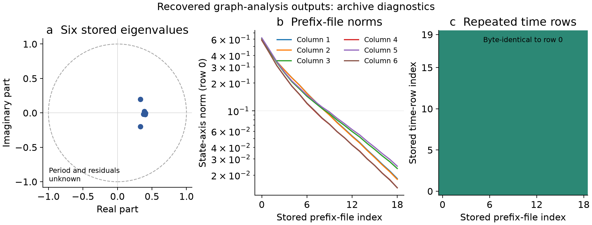

# Recovered graph-analysis results: what the arrays establish

2026-10-14. **Descriptive numerical integrity is independently accepted.**
The recovered files contain decreasing norms across stored prefix indices,
but every envelope repeats its time rows exactly. They establish properties
of saved numerical outputs. Original trained-model behavior, Floquet
certification and harmful representation collapse remain unverified.



The [SVG](figures/legacy-array-audit-2026-10-14/legacy-array-audit.svg) is suitable
for export. The figure reads the published aggregate summaries only; it does
not run a model or revisit raw arrays. Its manifest records input, review,
renderer and output hashes. The first rendering had a clipped panel title and
is preserved outside Git; the final PNG was visually checked at original size.

## Verified observations

Exactly forty numerical result files, 468,187,088 bytes, were acquired from the
owner's Mila archive with matching sender/receiver hashes and stable source
metadata. All numeric headers, payload lengths, hashes and input identities
passed the frozen audit. No checkpoint, training dataset or large Jacobian was
transferred or deserialized.

Each of nineteen `envelope_i.npy` files has shape `(20,25600,6)` and complex64
entries. **All twenty rows in every file are byte-identical to row zero**,
including signed-zero bits. This is stronger than equality within a numerical
tolerance. The eighteen adjacent prefix files differ; their saved norm files
also differ. The two axes therefore carry different information: prefix-file
index changes the stored vectors, while the within-file time-row index does
not. The files cannot support a varying within-file envelope trajectory.

All **2,280** state-axis norm comparisons pass the prespecified directed rule:

```text
abs(float64_recomputed_norm - saved_float32_norm)
    <= 1e-6 + 1e-5 * abs(saved_float32_norm)
```

This validates the saved norm calculation at that tolerance. It does not
validate how the underlying vectors were generated. Row-zero norms decrease
across the displayed prefix indices: the six first-file norms are about
0.585–0.619, and the final-file norms about 0.0146–0.0250. These are Euclidean
norms of six stored columns, not a covariance dimension or task score.

The six stored eigenvalue magnitudes, in file order, are
`0.3885041522, 0.3873512928, 0.4073697283, 0.4008433318, 0.3918987070,
0.3797840201`. Their phases remain radians per unspecified stored product.
The recovered values do not match the inherited draft's stated 0.41–0.44
range; the draft and these files are not linked to the same producer, so this
is a discrepancy to resolve, rather than a justified numerical correction to
that draft. Six values do not certify the full spectrum or identify its leading
modes without solver/provenance evidence.

The independent reducer uses different chunk sizes and float64 reductions.
It reconciles **11,700 scalar comparisons with zero mismatches**, with maximum
floating-summary discrepancy `7.771561172376096e-16`. It retains the original
norm criterion unchanged. Producer and verifier each ran once, in 3.42 and
4.15 seconds respectively, on one numerical thread with no GPU, model forward,
gradient or optimizer call. Both supervisors observed their owned processes
exit with no cleanup errors. Both runs have twenty verified contemporaneous
offline W&B history records and completed summaries; cloud sync is pending.

## Interpretation and remaining questions

The repeated rows agree with the pattern generated by the inspected June
source's repeated-prefix construction. The arrays predate that source. This
agreement does **not** establish the original producer or prove that the known
source bug caused these files. A constant stored array could also arise from
another definition or producer. The supported finding is the exact redundancy
of the saved time axis.

Interpreting that redundant axis as twenty independent dynamics observations
would be an analysis error. Centering it would produce a zero time-variation
matrix by construction; that would say nothing about the trained network's
useful state dimension. These envelopes are tangent-vector-like stored outputs,
not verified hidden/cell-state histories. Norm decay across prefixes likewise
does not prove loss of independently written, task-required information.

The full Jacobians, exact product chronology, original weights, input histories,
state adapter, solver residuals and orbit closure remain unlinked. Consequently,
the six subunit magnitudes do not yet certify Floquet stability, and ordinary
contractive directions cannot establish harmful memory collapse. The original
T-GRAB behavioral result has not received a negative replication: current vector
competence failures and this archive audit are different studies.

The next graph milestone is a labeled reconstruction of `Pdet(2,32)`, period
64, with the actual pinned native GC-LSTM and link head. Its corrected
[component implementation](tgrab-reconstruction-implementation-2026-10-14.md)
and [independent review](tgrab-reconstruction-implementation-independent-review-2026-10-14.md)
now cover state layout, causal chronology, negative sampling, metrics and
selection guards. Twenty-eight synthetic spy tests pass. Native dependencies,
locked graph environment, data conversion/provenance, native parity fixtures,
checkpoint/reporting orchestration and physical runtime supervision remain
unfinished. No native graph training is admitted or running.

## Reproduction and evidence

The [aggregate audit JSON](legacy-floquet-array-results-2026-10-14.json) and
[final verification receipt](legacy-floquet-array-verification-2026-10-14.json)
are tracked byte-for-byte copies of accepted outputs. They contain numerical
summaries and identities, not raw state vectors, weights or training data.
This makes the figure reproducible without accessing the private archive:

```bash
MPLCONFIGDIR=runs/legacy-figure-cache .venv/bin/python -B \
  code/analysis/plot_legacy_floquet_audit.py \
  --audit doc/auto/legacy-floquet-array-results-2026-10-14.json \
  --audit-sha256 c201ecf6e8451a2aef32c37a69360eccd49dbf376d47bb36472e52b59d6d4fdf \
  --review doc/auto/legacy-floquet-array-verification-2026-10-14.json \
  --review-sha256 97e42bb4c791f72dabf948c279ddcdd6a421c936845fce611d632b15a10172c1 \
  --output runs/legacy-figure-reproduction-NEW
```

Use a new output directory. The pinned producer is commit `351fa68`; the
independent verifier is commit `936600c`. The immutable input manifest SHA-256
is `e8299018314cffc6a023b78b60027e1aa979f424ee89c401532993cde5305c7f`.
Raw input replicas remain under ignored
`runs/graph/legacy-array-acquisition-20261014T1628Y/inputs/`.
The [independent closeout](legacy-floquet-array-results-independent-review-2026-10-14.md)
records exact source, admission, output, supervisor and reporting evidence.

Engineering acceptance means the reviewed components enforce their scoped
contracts. Numerical acceptance means independent calculations reproduce the
stored-file diagnostics. Neither is an acceptance of a trained-model collapse
mechanism or an authorization to launch new cluster work.
