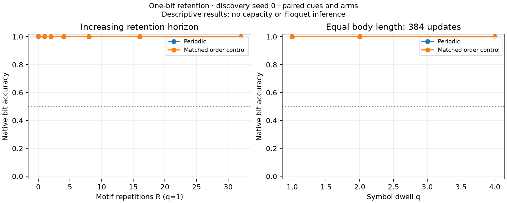

# One-bit retention under repeated motifs: verified discovery result

**Decision (2026-10-23):** The frozen seed-0 LSTM retains the written bit on every evaluated episode. The specified periodic-order intervention produces **zero excess error** through 384 body updates. This is a valid negative result for this model, task and horizon; it does not establish a general absence of repetition-induced forgetting.

The prospective protocol is [one-bit memory discovery v1](onebit-memory-discovery-v1.md), frozen in source commit `790fb9443565941a3cff9cd01c5a034d24480c18`. One cluv Tamia CPU job, `633041`, ran on `tc11103` with account `aip-ioannism`, one CPU, 4 GiB requested, zero GPUs and a two-hour cap. Accounting reports `COMPLETED 0:0`, elapsed `00:01:00`, batch MaxRSS 476828K. The complete, hash-locked checkpoint and full recurrent-state arrays remain in project scratch. No retraining or favorable-checkpoint selection followed the result.

## Acquisition and held-out result

All 5,000 scheduled Adam updates are present and in frozen curriculum order. At each of the three validation boundaries, **every required cue × arm × horizon cell scored 512/512**, exceeding its prespecified 487/512 competence gate. Only after the final gate did the worker generate and open held-out panels using the separate seed-3000 stream. The final checkpoint digest was frozen before evaluation and checked afterward.

Each held-out condition contains 1,024 sampled forcing schedules crossed with both bit values and both arms: 4,096 episode rows. The independently reduced results are:

| Motif repeats `R` | Symbol dwell `q` | Body updates | Periodic bit accuracy | Matched-control bit accuracy | Periodic minus control error |
|---:|---:|---:|---:|---:|---:|
| 0 | 1 | 0 | 1.000 | 1.000 | 0.000 |
| 1 | 1 | 12 | 1.000 | 1.000 | 0.000 |
| 2 | 1 | 24 | 1.000 | 1.000 | 0.000 |
| 4 | 1 | 48 | 1.000 | 1.000 | 0.000 |
| 8 | 1 | 96 | 1.000 | 1.000 | 0.000 |
| 16 | 1 | 192 | 1.000 | 1.000 | 0.000 |
| 32 | 1 | 384 | 1.000 | 1.000 | 0.000 |
| 16 | 2 | 384 | 1.000 | 1.000 | 0.000 |
| 8 | 4 | 384 | 1.000 | 1.000 | 0.000 |

The primary descriptive contrast `δ16` is 0, anchor `δ2` is 0, and `δ16−δ2` is 0. At equal 384-step body duration, changing symbol dwell and motif repeat count also leaves both arms perfect. All nine panels are reported; none was chosen by outcome. The matched control preserves symbol counts, adjacent bigrams, runs, endpoints, final motif and duration, while higher-order order and predictability differ. These are the actual intervention properties; the data do not isolate abstract periodicity from every other structural property.

Complete H+C opposite-cue separation before QUERY is nonzero in every panel and its mean raw L2 distance rises from 2.446 at R0 to 493.732 at R32/q1 (587.676 at R8/q4). Pooled-cue, per-arm raw H+C participation ratios are approximately 1.000 throughout, while covariance trace grows sharply; at R32/q1 it is about 60,973. These summaries were **reported by the worker and bound by its artifact hashes, but the retained state arrays were not independently recomputed locally**. The rank-one-looking pooled geometry is dominated by the intentionally varied single bit. It is compatible with perfect useful memory, so it cannot be described as harmful representation collapse. The growth of raw C separation also cautions against treating the trace as a stable scale-normalized dimension measure.

Full H+C opposite-cue swaps reproduce donor logits exactly by construction and score 0 against the recipient labels, while self-copy and same-cue different-draw copies score 1; zero-state readout scores 0.5. These controls confirm dependence of this native readout on retained state, but they do not identify a memory subspace or distinguish information erasure from readout failure in harder settings. An input-target WRITE oracle scores 1.0; this is a renderer integrity check rather than a separately executed recurrent register.

## Acceptance and limits

The independent compact reducer verifies all 5,000 training rows, stage decisions, 36,864 held-out episode rows, cue/arm chronology, schedule constraints, paired error arithmetic, native logits and exact intervention donor replays. It checks hashes for every returned compact artifact and inventories the uncollected checkpoint/state payloads. Ten focused reducer tests pass. A separate audit checks source and runtime identity, Slurm outcome, the actual offline W&B protobuf stream (201 histories with exact logged training losses), metadata artifact, terminal stream exit and completed reporting receipt. The source file and protocol hashes match commit `790fb94`; result SHA-256 is `ab36f689f337d57ebfe165a523c772c4a6dd7404155781dadf3b5e92270886ba`. Remote W&B delivery is unverified; the durable local offline stream is verified.

The [compact evidence and plot](figures/onebit-memory-2026-10-23/manifest.json) contain the reducer result, scheduler and reporting receipts, identities and hashes. Scratch retains raw rows, designs, checkpoint and states at `representation-collapse/runs/onebit-memory/onebit-20261020T204921Z-790fb944`. There is one trained seed, one stored bit and finite tested horizons. Forcing draws, opposite cues and arm copies are dependent, and finite motif combinations recur. This result neither measures memory capacity nor supplies a tangent/Floquet spectrum. It provides a competent counterexample to inferring harmful forgetting from low pooled covariance dimension. The next experiment should increase independently queried memory load while preserving paired forcing and competence gates.
