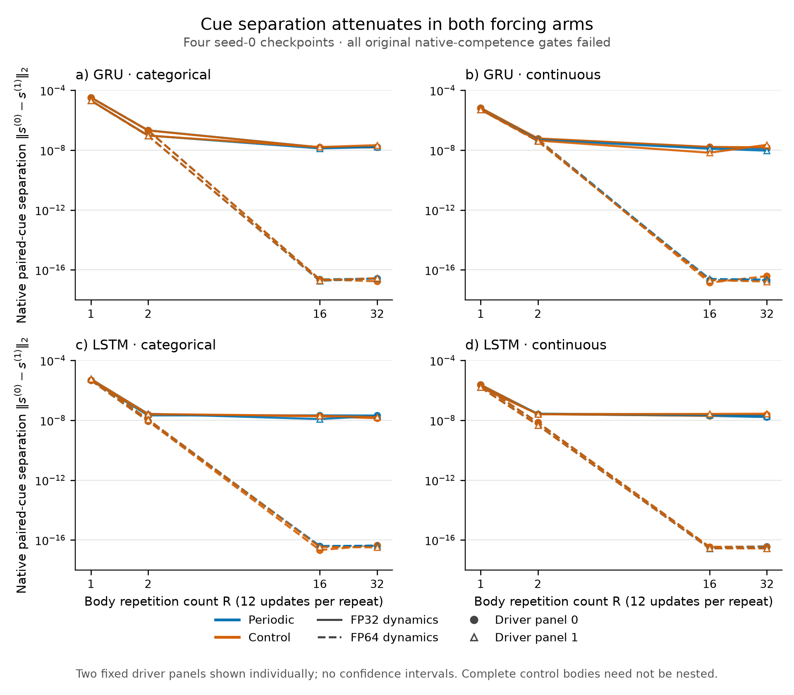

# Independent periodicity reduction: descriptive results

The frozen [independent protocol](periodicity-independent-reduction-v1.md) passed its raw-array numerical audit for all four seed-0 checkpoints. **Every original native-competence gate failed; harmful collapse and Floquet claims remain unaccepted.** This report contains newly verified measurements, with no retraining or new model selection.

The committed [scalar summary](periodicity-independent-results.json) preserves exact per-panel, arm, precision and horizon values, terminal native/manual closure diagnostics and local-spacing ratios. The original arrays and weights remain on cluster scratch.



**Figure.** Absolute pre-QUERY separation of two required-cue histories with shared nuisance and body inputs, using native one-step recurrent updates. GRU uses 128 hidden coordinates; LSTM uses all 256 `[h,c]` coordinates. Color denotes forcing arm; solid/dashed lines denote FP32/FP64; circles/triangles show the two fixed driver panels individually. No centering or scale normalization. All plotted separations are nonzero; zeros would be shown on a separate strip, never replaced by a positive floor. Lines join measured points for readability: control source prefixes are shared except for forced terminal motifs, so complete bodies need not be nested across horizons. These repeated measurements of one seed per cell are not independent replicates or confidence intervals. R1 is an identical-arm anchor; R32 extends the original R16 evaluation horizon and has state measurements only, with no tangent or Jacobian assay.

Measured findings:

- At R16/R32, native FP32 cue separation is 6.73e-09–2.77e-08 across both arms and all cells. Every pair remains bitwise different (33–108 changed coordinates); small amplitude does not establish an exactly merged state or the absence of decodable information.
- At R16/R32, native FP64 cue separation is 1.39e-17–4.54e-17 across both arms and all cells. Every pair remains bitwise different (29–85 changed coordinates); small amplitude does not establish an exactly merged state or the absence of decodable information.
- All 64 observed 12-step manual tangent gains are below one (0.00417–0.0126). Per-cell ranges are GRU categorical: 0.010104–0.010113; GRU continuous: 0.01263–0.012642; LSTM categorical: 0.0041699–0.0041888; LSTM continuous: 0.0056381–0.0056414. These are local finite-time products at cue zero, not cue-channel derivatives, native readout tests or certified monodromy matrices.
- At R32, all 16 periodic native FP32 last-cycle comparisons pass frozen tolerances: absolute block residual 4.78e-08–9.45e-08. None is bitwise equal; maximal coordinate differences are 64–961 local spacings. All 16 control comparisons fail (residual 0.373–0.489); their adjacent blocks need not have identical inputs. Tolerance-qualified closure does not certify an exact orbit.
- At R32, all 16 periodic native FP64 last-cycle comparisons pass frozen tolerances: absolute block residual 8.2e-17–1.74e-16. None is bitwise equal; maximal coordinate differences are 57–535 local spacings. All 16 control comparisons fail (residual 0.373–0.489); their adjacent blocks need not have identical inputs. Tolerance-qualified closure does not certify an exact orbit.
- LSTM categorical, driver panel 1, control R16, FP32: both manual last-cycle checks pass (7.84e-08–9.25e-08), while both native checks fail (1.03e-07–1.07e-07) the unchanged `1e-7` absolute bound. The driver has no proper whole-body period. Adapter tolerance passes do not preserve closure classifications at this scale; no threshold was relaxed.

Limits and interpretation. Two histories give at most rank-one centered covariance and cannot estimate representation dimension. Both forcing arms attenuate these particular cue differences, without establishing their population ordering effect or empirical equivalence. One checkpoint per cell, two fixed driver panels, arithmetic dependence, non-nested complete control bodies and failed native competence prevent a learned harmful-collapse conclusion. Manual QUERY arrays and original probe clouds were not saved, so query-adapter validation is partial and probe-floor robustness remains pending. Numerical reduction does not establish a causal mechanism, competent-model equivalence or transfer across modalities.

Provenance. Training `9004a0c114a8b7c5335dca3d5247449fd10b5ffa`; diagnostic producer `458bc9cfce474b8e11e433e33bf132faf5032387`; independent reducer `ec1c489fc97c2e6cf94fd58e8a4e04dd3e8ba901`, SHA-256 `8c8acfc68ae82baa7f746673ad56ea47be667a4d53cb015e5171c18ad2708bf4`. Tamia job **612745** completed `0:0`, 2026-10-12 09:00:41–09:00:55 UTC (14 s), maximum recorded step RSS 684,480 KiB, one CPU/2 GiB/zero GPUs. It verified 64 tangent windows and 1,536 step-Jacobian evaluations. The reducer checks frozen checkpoint identity, not checkpoint file bytes; the coordinator's earlier integrity evidence remains separate.

Reproduce the vector [PDF](figures/periodicity-independent-v1.pdf), PNG and report from the committed scalar summary (no raw arrays needed):

```bash
.venv/bin/python code/analysis/summarize_periodicity.py
```

The [figure manifest](figures/periodicity-independent-v1.manifest.json) records source/report hashes, exact plotted values and deterministic render outputs. The locked paper dependency group supplies Matplotlib. Scientific acceptance remains the coordinator's separate decision.
