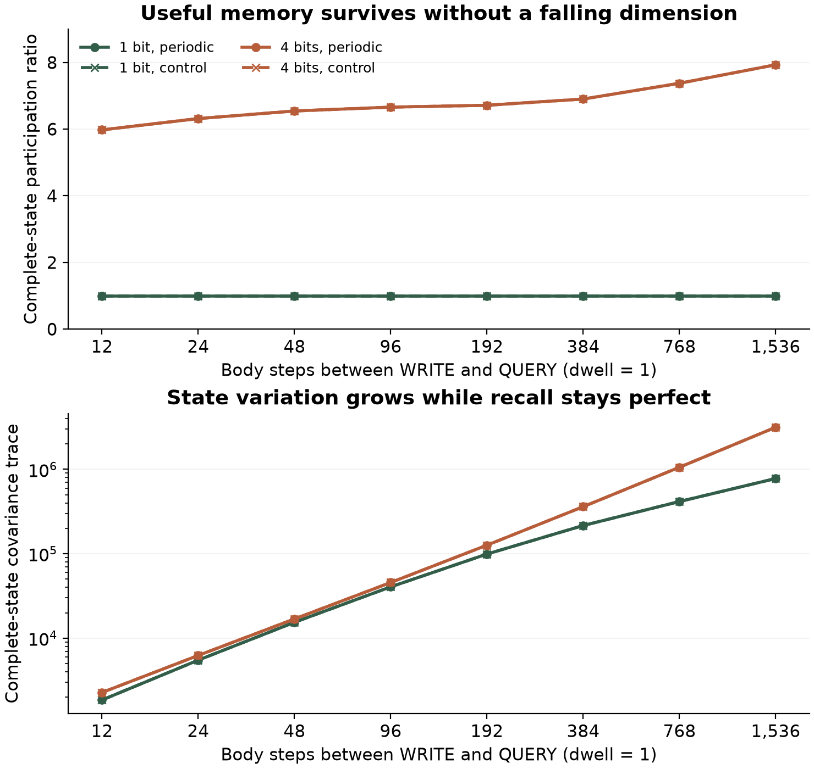

# Memory-load discovery: recall survives at one and four bits

November 16, 2026. Run `multibit-20261116T2243Z-s0`, source
`5e432540731a2b1c6df82dad73da63bd110dc53e`, Mila job **11741707**.
This is an exploratory, single-seed result. No harmful representation-collapse
or trained-model Floquet claim is accepted.

## What was tested

The [prospective protocol](../../cross-cluster/experiment/multibit-memory-v1.md)
fixed four separate fits at D=1,4,16,64 binary cue coordinates, using the same
69-channel input, LSTM hidden size 64, complete H+C state size 128, and 64-logit
head. A single WRITE contains the cue vector; the distractor body and QUERY
contain no cue payload. QUERY requests the full vector. These are categorical
source bits, not D continuously valued degrees of freedom or late addressed
queries. Total WRITE energy grows with D; mean per-bit loss and separate
training fits also limit interpretation of a load comparison.

The fixed acquisition recipe has 2,000 updates without a body, 4,000 updates
cycling through zero/one/two motifs, and 4,000 updates adding four/eight motifs.
Each stage requires at least 95% accuracy for every bit, cue polarity and
forcing arm at its specified validation horizons. The first failed stage
stops that fit before held-out evaluation; no rescue training was performed.

After competence, the endpoint faces ten frozen test conditions: R=0,1,2,4,8,
16,32,64,128 at symbol dwell q=1, plus R32q4. The last two conditions have the
same 1,536-step body. Each condition uses 256 balanced cue vectors, four
independent forcing draws, and paired periodic/control arms: 2,048 episode
rows. The same cue panel is reused across horizons and forcing units, so the
rows, bits and time points are not independent training replicates.

## Observed outcomes

- **D=1 and D=4:** both reached 10,000 updates and their saved validation
  summaries report all three gates passed, with every required polarity/arm
  accuracy equal to one. Held-out bit accuracy and whole-vector exact-match
  accuracy are **100% in both arms in all ten conditions**, including both
  ways of reaching 1,536 body steps. Each fit contributes 20,480 episode rows.
  The primary periodic-minus-control bit-error difference at R32q1 is zero,
  the R2q1 anchor is zero, and their difference in differences is zero.
- **D=16:** stopped at 6,000 updates after stage 2. Its worst required
  bit/polarity/arm accuracy is 0.8984375 at both R1 and R2, below 0.95.
  Its R0 validation minimum remains one. No held-out test was opened.
- **D=64:** also stopped at stage 2. Its corresponding minima are 0.9453125
  at R0, 0.78125 at R1 and 0.765625 at R2. Even immediate recall falls below
  the gate after this acquisition stage. No held-out test was opened.

The larger-load failures concern acquisition under this recipe. They do not
show that periodic repetition erased a previously reliable delayed-memory
skill, nor locate an architectural capacity limit. The successful four-bit
fit extends the negative retention finding beyond a single bit, but remains
a small categorical task.

## State geometry

For each forcing draw and arm separately, the reducer centers 256 complete
H64+C64 cue states immediately before QUERY, then computes the unrescaled FP64
sample covariance with denominator 255. It does not pool input phase or
forcing means into a cue-memory dimension. Participation ratio (PR) summarizes
covariance geometry, not source bits or recoverable information.

At D=1, PR remains approximately one while covariance trace grows. At D=4,
mean periodic-arm PR rises from **4.0699 at zero body steps** to **7.9303 at
1,536 steps** with q=1; the matched control is nearly identical. Periodic-arm
trace rises from **8.6827** to approximately **3.15 million** in the raw H+C
coordinates. The four-bit support contains at most 16 distinct cues, hence
the centered covariance rank ceiling is 15, not four. A nonlinear encoding
can therefore have PR greater than the number of binary source coordinates.

These measurements do not show shrinking covariance dimension or absolute
cue-state variation for the competent loads. Large state variation does not
prove useful capacity either; native recall supplies the accompanying task
measurement. Cell coordinates are not squashed into [-1,1], and can change
greatly even when hidden outputs saturate. Orbit closure and tangent spectra were not measured,
so neither periodic attractors nor Floquet multipliers are established.

The figure shows dwell1 and averages four conditional summaries per arm;
periodic/control curves nearly overlap. These are descriptive curves without
seed-population uncertainty. See [plot provenance](multibit-assets/multibit-plot-provenance.json).

## Verification and material limitations

The [submission ledger](../../cross-cluster/submitted-jobs/multibit-race.md)
records the cluv race, source/environment pins, five actual submissions and
all cancellations. Mila completed `0:0` in 314 seconds. All files listed in
the four producer inventories were rehashed on Mila, including checkpoints;
all matched. Derived JSON/NPZ outputs alone were retrieved locally.

The independent NumPy reducer passes 861 integrity/numerical checks and recomputes held-out predictions, error contrasts,
covariance spectra, trace and PR without importing the producer's reducers.
Its [receipt](multibit-independent-reduction.json) records file checks,
tolerances and comparisons. The largest absolute difference from the producer's
covariance summaries is 2.328e-09, within the frozen comparison
tolerance of 1e-8 absolute plus 1e-6 relative. Three targeted corruption tests
reject missing campaigns, incorrect inventory hashes and misaligned arrays. This accepts the arithmetic of saved held-out
outputs as descriptive evidence; it is not independent forward replay of
the checkpoints or scientific acceptance of a collapse mechanism.

**Protocol deviation:** validation logits and explicit correct/total counts
were not retained, despite the prospective count requirement. The saved
design specifies 256 balanced cues and 128 examples per polarity. The reducer
checks the summary rates, inferred integer-count consistency and threshold
decisions, but cannot reconstruct actual validation predictions. Earlier
stage checkpoints were overwritten by later endpoints. Competence is thus
worker-reported and summary-checked; the final endpoint can be independently
replayed later, while earlier-stage raw predictions cannot be recovered from
the artifacts. Future attempts must retain them. This limitation is not hidden
by perfect held-out scores.

There is one training seed per load, four forcing draws per condition, a finite
reused cue panel, one LSTM architecture, and no independent confirmation.
Native readout success/failure is separate from decoding capacity, causal use,
noise robustness, basin structure and tangent contraction. No population
confidence interval or universal preservation claim follows.

## Reporting and next decision

All four original offline W&B histories were synchronized to
`mehrab-hamidi-milaquebec5431/representation-collapse`. A separate API check
verifies finished cloud state, contiguous histories (215 steps for D1/D4,
123 for D16/D64), uploaded metadata artifacts, and agreement of 50 selected
held-out summary values per successful fit. The
[cloud receipt](multibit-wandb-cloud-verification.json) contains the run links.
Failed acquisition remains recorded as such even though its execution and
reporting completed normally. Original offline receipts remain immutable.

The next useful acquisition study is a prospectively fixed, validation-only
comparison for D16/D64, with raw validation retention and final checkpoint
replay. Candidate explanations include curriculum difficulty, per-bit gradient
scaling and optimizer behavior; these results do not discriminate among them.
Keep the failed attempts and do not select a new recipe using D1/D4 held-out
contrasts. Once a larger load passes competence, use fresh held-out cue/body
draws and independent seeds, then test continuous cues and late addressed
queries. Connect subsequent tangent measurements to cue-related directions,
with finite-difference/dense calibration and orbit closure checks before any
Floquet interpretation.
