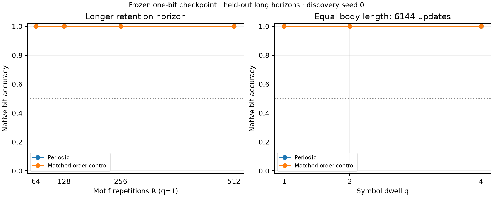

# Frozen one-bit memory through 6,144 body steps

**Verified discovery result, 2026-10-23.** The same seed-0 LSTM checkpoint that had perfect one-bit recall through 384 body steps also scored **100% in both the periodic and matched-order arms** at every prespecified longer horizon through 6,144 body steps. The periodic-minus-control error is zero at each horizon. This is a finite negative result for repetition-induced harmful forgetting in this one-bit model; it is not a capacity or general recurrent-model result.

The [prospective extension protocol](../../../2026-10-26/local/auto-research/onebit-long-horizon-v1.md) froze source `37f9952a10eba22c761534909b8d51b5cec523d2`, the existing accepted checkpoint/result hashes, independent test seed 4000, six conditions and 512 forcing draws per condition before any held-out extension. No weights changed. Native cluv submitted one Tamia CPU job, **639080**, account `aip-ioannism`, one CPU/4 GiB/zero GPUs, two-hour cap, no retry or race. It completed `0:0` on `tc11101` in `00:00:55` with batch MaxRSS 484184K.

| Repeats `R` | Dwell `q` | Body steps | Periodic accuracy | Control accuracy | Paired error difference |
|---:|---:|---:|---:|---:|---:|
| 64 | 1 | 768 | 1.000 | 1.000 | 0.000 |
| 128 | 1 | 1,536 | 1.000 | 1.000 | 0.000 |
| 256 | 1 | 3,072 | 1.000 | 1.000 | 0.000 |
| 512 | 1 | 6,144 | 1.000 | 1.000 | 0.000 |
| 256 | 2 | 6,144 | 1.000 | 1.000 | 0.000 |
| 128 | 4 | 6,144 | 1.000 | 1.000 | 0.000 |

Each row uses 512 sampled forcing draws crossed with opposite bit values and both arms, giving 2,048 episode rows. The reducer checked all **12,288** rows and the actual matched body designs. The primary R512/q1 contrast, R64/q1 anchor and their difference are all zero. Native cross-entropy stays near `1.30×10⁻⁷` for q1 and near `1.0×10⁻⁶` for q2/q4. Full-state opposite-cue swaps, self-copies and same-cue donor replay match the native logits exactly; the swap scores zero against the recipient's label, while zero-state readout is at chance.

The worker's unrescaled complete H+C summaries show mean pre-QUERY opposite-cue L2 separation growing from about 585 at R64/q1 to 634 at R512/q1, and roughly 865–873 at equal-length q2/q4. Pooled-cue per-arm covariance participation ratio stays near one while trace grows. These summaries are hash-bound in the retained condition artifacts, but the state arrays were not independently recomputed locally. Since the bit remains exactly readable and causally controls the native output, low pooled PR here does **not** imply loss of useful information. Absolute state scale, including cell-state growth, matters; PR alone hides it.

## Acceptance and boundary

The independent reducer verifies every compact artifact hash, all six schedule designs, every raw logit/prediction/error row, paired contrasts and exact intervention replay. A separate audit checks the source/protocol and trusted parent checkpoint identities, actual Slurm result, runtime, seven offline W&B history rows, metadata artifact and terminal reporting receipt. Result SHA-256 is `8b2f56d993215adb4ea71910b033d9b1fe50ea2d566e31e0c1234246ce829b09`; offline stream SHA-256 is `ddf8fb13df9223908227b12767eefb767cf8ec193351b68d6ee28bc8daeff0d2`. The [plot and compact evidence](../../../../../doc/auto/figures/onebit-long-horizon-2026-10-23/manifest.json) are stored in Git. The checkpoint remains in the parent one-bit run on Tamia scratch; new full state arrays are in `representation-collapse/runs/onebit-long-horizon/onebit-long-20261023T155355Z-37f9952a`. Online W&B delivery is unverified.

There is one trained seed and one stored bit. Cue flips, arm copies and repeated draws are dependent observations; the experiment cannot estimate a model population or memorization capacity. Matching constrains low-order body statistics, while higher-order ordering and predictability still differ. There is no tangent/Floquet measurement or precision-sensitivity audit. The next discriminating study should store several independently variable bits, reveal only one query address after the body, gate competence per address/cue/arm, and then compare paired periodic and control retention at fixed weights. A decline in both arms would indicate generic horizon failure; a periodic-specific excess requires a positive paired contrast with competent controls.
