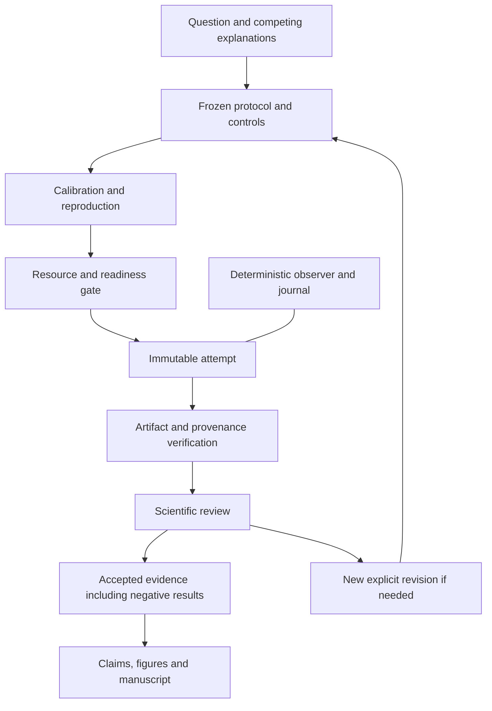

# Research architecture

Keep four layers separate: scientific intent, immutable execution inputs, live
operations, and accepted evidence. A change in one layer must not silently rewrite
another. This works for theory, numerical analysis, training and paper-only work.

## Project layout

`project.json` identifies the question, owner, paths, timezone and authorization
record. `src/` contains scientific implementation; `configs/` contains frozen
protocols and experiment manifests. `tests/` covers numerical invariants and
toy end-to-end checks. `scripts/` contains reproducible entrypoints.

`docs/PROTOCOL.md` freezes hypotheses, estimands, independent sampling units,
controls, exclusions, selection/evaluation boundaries, failure treatment and stop
rules. `docs/TRACKER.md` records current state. `docs/notebook/YYYY-MM-DD.md`
preserves dated observations and decisions. Existing projects may retain their
`doc/<month>/<day>` convention; adoption does not rename history.

`paper/` holds manuscript source and accepted figures. `literature/` holds cited
notes with source links, assumptions and limitations. `skills/` is canonical;
`.agents/skills/` uses regular-file discovery pointers so Overleaf-compatible
repositories need no symlinks. `runs/`, datasets, environments and weights are
external or ignored. Scratch is working storage, never the sole accepted archive.

## Scientific contract

Every experiment fixes a falsifiable question, the alternative explanation it
tests, a minimal discriminating comparison, and its acceptance criterion before
held-out results are inspected. A scientifically accepted negative result is
useful progress. Do not redefine the endpoint after seeing the data.

For theory, separate assumptions, lemmas, proof gaps, counterexamples and empirical
support. For numerical work, calibrate the observable and test known limiting
cases. For training, pin data revision, splits, seeds, preprocessing, initialization,
loss, optimizer, precision, effective batch and full-state resume semantics.

Every result records source commit, lock/config/data/protocol hashes, cluster,
job/array/step and attempt IDs, timestamps, units and expected artifacts. A figure
must trace to its aggregation command and underlying runs; a sentence must trace
to its evidence and qualification. Preliminary manuscript assertions stay claims
until reproduced. Imported code and papers remain attributed source snapshots.

Interpretable results from monitored scientific jobs must be reported in the relevant W&B
project/subproject, including baselines, comparisons, ablations, evaluations and
valid negative or partial results. Verify delivery and record result links or an
explicit pending-reporting state. See [results reporting](results-reporting.md).

## Operations and autonomy

Use [Git as the primary synchronization mechanism](source-sync.md) for versioned
source, configs, skills and documentation between local and cluster checkouts.
Keep queued and running source pinned; transfer bulk assets separately with
verified manifests.

Use deterministic polling, checksums, readiness checks and bookkeeping. Invoke a
model for a substantive unresolved question, not a heartbeat. The coordinator owns
the research decision; a proposal does not submit itself. Choose from available
models according to task difficulty and the project's policy; no model aliases or
provider entitlement are assumed by this template.

Run persistent cluster coordination in a valid CPU allocation where site policy
requires it. Lease/heartbeat/host/socket ownership must be rechecked. Use one
authoritative controller and one private-host journal per campaign. A shared
compute host does not combine projects' scientific authority or compute budgets.
Publish small status snapshots; do not share a live SQLite WAL across hosts.

Plan → running → verified → accepted/rejected are distinct states. A failure is
retained; retries get new attempt identities. `submission_unknown` holds its full
reservation until scheduler reconciliation proves what happened. `PAUSE` stops
new dispatch; it does not imply cancelling running work. Renewals and requeues
consume the applicable envelope too.

## Implemented helper boundary

`scripts/research.py` is a local, deterministic journal and DAG validator. It
checks acyclicity, declared costs, dependencies, pinned plan identity, finite JSON,
artifact hashes and explicit review transitions. It never launches a cluster job,
model worker, arbitrary shell command or background research process. The skill
uses normal tools to execute an authorized ready task and records its evidence.

Production unattended dispatch needs a project adapter with transactional resource
reservation, scheduler reconciliation, lease expiry, ownership locks, source
deployment verification and an explicit executor allowlist. Reuse the owning
project's mature controller after review; do not copy its live journal or invent a
second controller. See the inspected Radius and Skill Inference implementations
in `sources/index.json` for provenance, not automatic installation.

Documentation uses `docs/MONTH/YYYY-MM-DD/CLUSTER/[SUBPROJECT]/TYPE/...md`;
see [documentation and reporting scope](documentation-layout.md). Routine preprocessing,
progress-only work and infrastructure checks do not create W&B runs.
