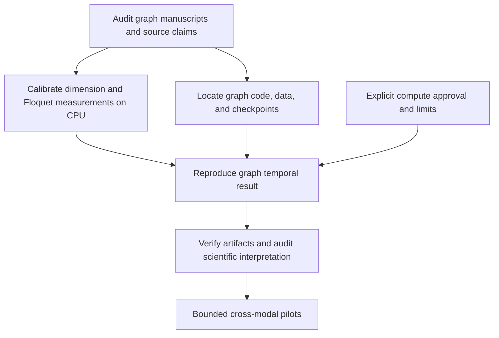

# Research DAG and artifact contract

## Scientific dependencies

The initial plan is `configs/research-plan.json`. It is a versioned declaration
of research intent, not a running controller. Edges represent required evidence,
never a requirement that a predecessor's scientific hypothesis be true.

Graph reproduction can run locally with suitable bounded inputs; the approval
edge applies whenever its execution requires external resources. Initial targets
for later pilots are recurrent sequence models on synthetic signals, audio, and
vision. They are candidates, not approved datasets or training allocations.
Compare models using matched task complexity, state definitions, measurement
windows, and performance controls. Modalities and units are not interchangeable
replicates; report the actual population studied.

## Freeze each experiment

Before execution record the question, falsifiable hypotheses, intervention/null
controls, source/model/data revisions, state definition, recurrence map, period,
burn-in, evaluation window, seeds, tolerances, and selection rule. Choices using
validation data must precede examination of held-out outcomes. A smoke run
validates instrumentation, not the full hypothesis. Label deviations from the
source reconstruction explicitly.

For a discrete recurrence `s[t+1] = F(s[t], x[t])`, compute the period map
Jacobian in temporal order `J[T-1] ... J[0]`. Include all recurrent state needed
for the map to be Markovian, including cell state for an LSTM. Test finite
perturbations against the linearization at decreasing amplitudes and verify
orbit closure and input/Jacobian periodicity before calling its spectrum
Floquet multipliers. A finite-window Jacobian product remains useful when
periodicity fails, but must retain that label.

Separate observations:

- Centered trajectory covariance measures across samples or time; it is not
  the local tangent operator. Record centering, grouping, units, normalization,
  finite sample rank ceiling, and zero-variance behavior.
- Participation ratio and explained-variance dimensions require an explicit
  eigenvalue normalization and threshold. Report sensitivity to window length,
  noise, state scale, and near-zero singular values. Zero variance is a
  degenerate case, not evidence of useful learned compression.
- Period eigenvalue magnitudes describe local asymptotic stability. Singular
  values and multi-period perturbation growth expose transient amplification
  for non-normal dynamics. Stability alone does not establish low dimension.
- Periodic input can drive sustained spectral peaks despite contracting
  homogeneous perturbations. Fourier peaks alone do not establish autonomous
  memory or a unit-modulus multiplier. Use forcing/removal and phase controls.

Calibration should include known-rank centered trajectories, isotropic/noisy
baselines, constant trajectories, a known diagonal period map, noncommuting
Jacobians, a non-normal transient example, and perturbation error scaling.
Synthetic fixtures certify implementation behavior and expose estimator limits;
they do not count as independent model replications.

## Reproducible artifacts

Use an immutable experiment ID and a unique directory for each attempt beneath
`runs/<experiment_id>/attempt-<n>/`; large remote files may live in cluster
scratch with local manifests. Do not overwrite a failed or superseded attempt.
Each run contract identifies required outputs before execution:

- `config.json`: exact argv, timestamp, code commit and dirty patch hash,
  environment/lock identity, RNG seeds, model/data/checkpoint hashes, state and
  metric definitions, intervention labels, resource request, and host identity.
  Cluster runs additionally record Cluv invocation/config, cluster, account,
  scheduler IDs, actual allocation, elapsed time, and accelerator identity.
- `status.json`: experiment/node/attempt IDs, state, last update, exit code,
  failure category, and input/output references. An absent final writer after a
  timeout never implies success.
- `metrics.json`: named finite values with sample counts, split/window/phase
  identity, units, centering, threshold rules, uncertainty method, and available
  seed-level results. Degenerate/undefined values have explicit reason fields;
  do not silently convert them to zero.
- Output arrays/checkpoints sufficient for independent recalculation, plus a
  SHA-256 manifest and `verification.json` with checks, expected artifacts,
  pass/fail results, and verifier identity.

These are target contracts. A particular CLI may initially emit fewer files;
record the missing fields and adapt its output before accepting real-model
results. Do not claim enforcement that has not been implemented.

Verify dependency IDs, cycles, unique output paths, required input manifests,
and applicable resource limits before making a node ready. A reducer retains
missing/failed seeds and waits for its declared replication set. Neurons,
timesteps, covariance coordinates, and correlated modes are not independent
training replicates. Analyze paired seed-level contrasts where possible and
retain all failed or negative runs in the report.

## Execution states and scientific decisions

Use `planned`, `ready`, `running`, `succeeded`, `verified`, `blocked`, `failed`,
and `quarantined` for operational state. Cluster jobs may additionally use
`submitted`. A dependency releases only on declared verified outputs. Scientific
decisions separately use `pending`, `supported`, `unsupported`, or `inconclusive`,
with a precise claim, population, controls, uncertainty, and limitations.

Retries create new attempts and require a diagnosed cause and remaining limits.
Default mechanical repair allowance is one retry; new science or larger compute
is a new plan revision. Never repeat experiments until a desired sign appears.
Ambiguous submission requires scheduler reconciliation before retry: search by
unique experiment identity and inspect queued/running/completed jobs. Cluv
cluster races require an approved shared envelope and explicit loser cleanup;
count pending jobs and allocations on every candidate cluster.

## Monitoring and durable handoff

No persistent observer is installed by this setup. During an active session,
deterministic commands may inspect scheduler state and artifact manifests.
Only new evidence, a failed verifier, or a ready scientific decision justifies
reasoning/delegation; an unchanged queue does not justify another worker.

Future monitoring must preserve events atomically (temporary file then rename),
deduplicate event IDs, distinguish stale heartbeats from an empty queue, and
maintain one submission owner per plan. Design and authorization for persistent
execution are a separate milestone; documenting this contract does not start it.

Append a dated notebook entry under `doc/` with question/protocol revision,
commands, worker ownership, artifacts/checks, scientific interpretation,
negative findings, remaining unknowns, and next ready node. Update the tracker
and plan as concise views of that evidence; they are not transactional job
stores. On handoff point to exact paths and hashes instead of copying long logs.
